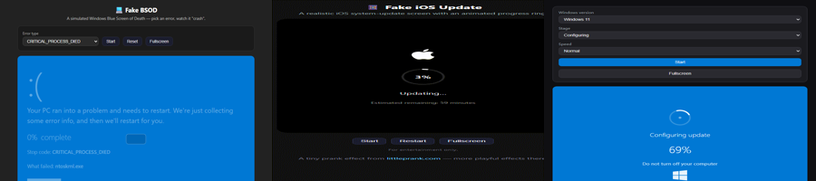

# littleprank — Fake Screen & Prank Effect Showcases

[中文版本 / Chinese version](README.zh-CN.md)

A collection of **self-contained, zero-dependency** HTML/CSS/JS demos extracted from [littleprank.com](https://littleprank.com) — a playful (and harmless) toolkit of fake screens, prank effects, and visual gags.

Each subfolder is a standalone showcase of one effect category. Just open the `index.html` inside any folder in a browser — no build, no install.

## Showcases

| Category | Demo | What it is |
|----------|------|-----------|
| 📱 Mobile (fake phone) | [fake-ios-update](fake-ios-update/) | iOS-style update screen, fake notifications, battery/charging pranks and more |
| 💻 System (fake OS) | [fake-bsod](fake-bsod/) | Blue screen of death, error popups, fake screens and more |
| 🪟 Windows (update & login) | [fake-windows-update](fake-windows-update/) | Windows 10/11 update screen, login & boot pranks, activation locks and more |

Each folder's `README.md` contains the full source plus a list of related **one-click tools** on littleprank.com.

## Live site

The complete collection lives on **[littleprank.com](https://littleprank.com)** — visit for every effect.

## License

MIT — free to use, modify, and share.
