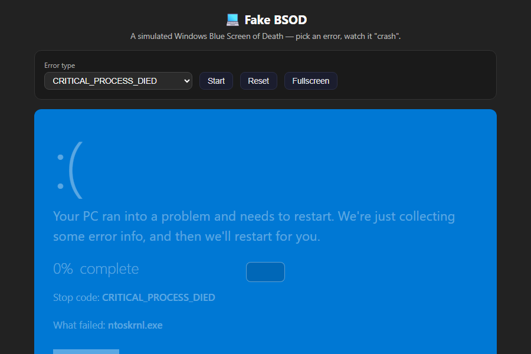

# 💻 Fake BSOD

A simulated Windows Blue Screen of Death. Pick an error type, hit **Start**, and watch it "crash" with a progress counter. Pure HTML/CSS/JS, zero dependencies — the QR code is pure CSS, no images.

▶ **Live demo on littleprank.com:** https://littleprank.com/en/tools/system/fake-bsod/



## What it does

- Choose a stop-code (CRITICAL_PROCESS_DIED, etc.); a random failing module is shown.
- **Start** animates the percentage 0 → 100, then "restarts" and loops.
- **Reset** returns to the idle hint state.
- **Fullscreen** fills the screen.

## Run it

No build, no install. Just open `index.html` in any browser.

## The core code

The "crash" loop just walks a counter and updates the label:

```js
var failedModules = ['ntoskrnl.exe','win32k.sys','nvlddmkm.sys','ndis.sys'];
function startBsod() {
  stopCodeEl.textContent = document.getElementById('bsod-error-type').value;
  failedModuleEl.textContent = failedModules[Math.floor(Math.random()*failedModules.length)];
  bsodProgress = 0;
  bsodInterval = setInterval(function() {
    if (bsodProgress < 100) {
      bsodProgress = Math.min(100, bsodProgress + Math.random()*4 + 1);
      percentEl.textContent = Math.floor(bsodProgress) + '%';
    } else { clearInterval(bsodInterval); setTimeout(startBsod, 1800); } // "restart" loop
  }, 180);
}
```

The full, runnable version (with error-type picker, Reset, Fullscreen) is in **[`index.html`](index.html)**.

## License

MIT.

---

A tiny showcase of **[littleprank.com](https://littleprank.com)** — more playful (and harmless) effects live there.

## One-click tools from littleprank.com

This repo highlights one effect — but the full littleprank.com **system** collection is listed below, with a short description of each. Every link opens the live tool directly:

- [Fake Windows Update](https://littleprank.com/en/tools/system/fake-windows-update/) — Simulate Windows update screen to prank your friends
- [Fake Blue Screen](https://littleprank.com/en/tools/system/fake-bsod/) — Simulate Windows BSOD error screen
- [Fake Hacker Terminal](https://littleprank.com/en/tools/system/fake-hacker-terminal/) — Simulate hacker attack terminal screen
- [Fake Virus Scan](https://littleprank.com/en/tools/system/fake-virus-scan/) — Simulate antivirus scanning screen
- [Fake Loading Screen](https://littleprank.com/en/tools/system/fake-loading/) — Simulate various loading progress bars
- [Fake macOS Update](https://littleprank.com/en/tools/system/fake-macos-update/) — Simulate macOS system update installation screen
- [Fake Chrome Update](https://littleprank.com/en/tools/system/fake-chrome-update/) — Simulate Chrome browser update page
- [Fake Shutdown](https://littleprank.com/en/tools/system/fake-shutdown/) — Simulate system shutdown animation
- [Fake System Error](https://littleprank.com/en/tools/system/fake-system-error/) — Simulate system error dialog
- [Fake Format Disk](https://littleprank.com/en/tools/system/fake-format/) — Simulate disk formatting interface
- [Fake BIOS](https://littleprank.com/en/tools/system/fake-bios/) — Simulate computer boot BIOS POST screen
- [Fake Windows Activation](https://littleprank.com/en/tools/system/fake-windows-activate/) — Simulate Windows not activated watermark and failure dialogs
- [Fake Permission Denied](https://littleprank.com/en/tools/system/fake-permission-denied/) — Spam administrator permission denied popups
- [Fake System Freeze](https://littleprank.com/en/tools/system/fake-system-freeze/) — Simulate complete system freeze with no response
- [Fake Registry Repair](https://littleprank.com/en/tools/system/fake-registry-repair/) — Simulate boot registry auto-repair progress
- [Fake MBR Boot Error](https://littleprank.com/en/tools/system/fake-mbr-error/) — Simulate disk boot failure black screen
- [Fake Kernel Panic](https://littleprank.com/en/tools/system/fake-kernel-panic/) — Simulate macOS Kernel Panic screen
- [Fake CMD Error Flood](https://littleprank.com/en/tools/system/fake-cmd-error/) — Simulate command line flooding with red errors
- [Fake Git Clone](https://littleprank.com/en/tools/system/fake-git-clone/) — Simulate endless git clone terminal output
- [Fake Compiling](https://littleprank.com/en/tools/system/fake-compiling/) — Simulate code compilation stuck at 99%
- [Fake Sudo Password](https://littleprank.com/en/tools/system/fake-sudo-password/) — Simulate Linux terminal password always wrong
- [Fake Browser Crash](https://littleprank.com/en/tools/system/fake-browser-crash/) — Simulate Chrome Aw Snap crash page
- [Fake Browser Memory](https://littleprank.com/en/tools/system/fake-browser-memory/) — Simulate browser out of memory crash
- [Fake Creative 404](https://littleprank.com/en/tools/system/fake-404-page/) — Multiple stylized 404 page not found designs
- [Fake PowerShell Terminal](https://littleprank.com/en/tools/system/fake-powershell/) — Simulate dangerous PowerShell commands with scrolling logs
- [Fake Remote Intrusion](https://littleprank.com/en/tools/system/fake-remote-intrusion/) — Display screen capture and camera access log stream
- [Fake WiFi Crack Terminal](https://littleprank.com/en/tools/system/fake-wifi-crack/) — Simulate cracking nearby WiFi passwords with packet animation
- [Fake Log Upload](https://littleprank.com/en/tools/system/fake-log-upload/) — Collect and upload error logs to server with progress bar
- [Popup Bomb](https://littleprank.com/en/tools/system/fake-popup-bomb/) — Endless popup error and warning dialogs scattered randomly
- [Window Drag Lock](https://littleprank.com/en/tools/system/fake-window-drag/) — Popup sticks to mouse cursor, close button does not work
- [Xiongmao Shaoxiang Virus](https://littleprank.com/en/tools/system/fake-xiongmao-shaoxiang/) — 1:1 recreation of the 2006 Windows Worm.WhBoy virus: panda-holding-incense icons, system error popup storm, CMD black console flood
- [Fake Driver Install](https://littleprank.com/en/tools/system/fake-driver-install/) — Batch install drivers with individual progress bars
- [Fake Data Backup](https://littleprank.com/en/tools/system/fake-data-backup/) — Simulate system data backup and restore progress
- [Fake Disk Full](https://littleprank.com/en/tools/system/fake-disk-full/) — C drive full popup repeatedly appearing, window cannot close
- [Fake Task Manager Freeze](https://littleprank.com/en/tools/system/fake-task-manager/) — Processes jumping, CPU memory maxed out, no response
- [Fake Explorer Crash](https://littleprank.com/en/tools/system/fake-explorer-crash/) — Folder windows auto-spawning, icons glitching and flickering
- [Fake GPU Crash](https://littleprank.com/en/tools/system/fake-gpu-crash/) — Full-screen colorful garbled display, color block tearing
- [Fake CPU Overheat](https://littleprank.com/en/tools/system/fake-cpu-temp/) — Temperature gauge spike, alarm popup, red screen flash
- [Fake Disk Bad Sectors](https://littleprank.com/en/tools/system/fake-disk-badblocks/) — Scan grid color blocks, red marks for virtual bad sectors
- [Fake Server Down](https://littleprank.com/en/tools/system/fake-server-down/) — Ops dashboard server offline, port occupied, service crash
- [Fake DevTools Intrusion](https://littleprank.com/en/tools/system/fake-devtools-intrusion/) — F12 console filled with red errors and malicious logs
- [Fake Steam Verify](https://littleprank.com/en/tools/system/fake-steam-verify/) — Steam game integrity verification progress bar
- [Fake Game Crash](https://littleprank.com/en/tools/system/fake-game-crash/) — UE4 Unity engine game crash error dialog and log
- [Fake Excel Freeze](https://littleprank.com/en/tools/system/fake-excel-freeze/) — Excel not responding, calculation progress stuck at 0%
- [Fake Word Recovery](https://littleprank.com/en/tools/system/fake-word-recovery/) — Document auto-recovery loading screen after crash
- [Fake Offline Page](https://littleprank.com/en/tools/system/fake-offline-page/) — Chrome offline dinosaur page, DNS resolution failure
- [Fake VPN Connect](https://littleprank.com/en/tools/system/fake-vpn-connect/) — VPN dial connection with frequent disconnect and reconnect
- [Fake Website Maintenance](https://littleprank.com/en/tools/system/fake-maintenance/) — Fullscreen maintenance overlay, website is upgrading
- [Fake Cloudflare Challenge](https://littleprank.com/en/tools/system/fake-cloudflare-challenge/) — CF human verification stuck, never finishes verifying
- [Fake 502 Error](https://littleprank.com/en/tools/system/fake-502-error/) — Simulate 500/502 bad gateway error page
- [Fake Site Shutdown](https://littleprank.com/en/tools/system/fake-site-shutdown/) — "Website permanently closed" announcement, nostalgic farewell page
- [Fake CAPTCHA](https://littleprank.com/en/tools/system/fake-captcha/) — Increasingly absurd "I am not a robot" verification, satirizing modern internet
- [Fake Win95 Login](https://littleprank.com/en/tools/system/fake-win95-login/) — Classic Windows 95 login screen with retro gray style
- [Fake Win98 Login](https://littleprank.com/en/tools/system/fake-win98-login/) — Windows 98 login screen with classic blue sky and white clouds
- [Fake WinXP Login](https://littleprank.com/en/tools/system/fake-winxp-login/) — Windows XP welcome screen with classic green taskbar
- [Fake Win7 Login](https://littleprank.com/en/tools/system/fake-win7-login/) — Windows 7 login screen with Aero glass effect
- [Fake Win8/8.1 Login](https://littleprank.com/en/tools/system/fake-win8-login/) — Windows 8/8.1 tile login screen with modern flat design
- [Fake Win10 Login](https://littleprank.com/en/tools/system/fake-win10-login/) — Windows 10 login screen with clean modern design
- [Fake Win11 Login](https://littleprank.com/en/tools/system/fake-win11-login/) — Windows 11 centered login screen with rounded corners
- [Fake Update Stuck](https://littleprank.com/en/tools/system/fake-update-stuck/) — System update stuck at 100% or "1 minute remaining" for half an hour
- [Fake macOS Login](https://littleprank.com/en/tools/system/fake-macos-login/) — Simulate macOS lock screen login with password unlock animation
- [Fake Linux Login](https://littleprank.com/en/tools/system/fake-linux-login/) — Simulate Linux terminal login with username and password
- [Fake Windows Lock Screen](https://littleprank.com/en/tools/system/fake-windows-lock/) — Simulate Windows lock screen, enter password to unlock
- [Fake System Recovery](https://littleprank.com/en/tools/system/fake-ghost-recovery/) — Simulate system restore / recovery mode progress screen
- [Fake Safe Mode Boot](https://littleprank.com/en/tools/system/fake-safe-mode-boot/) — Simulate safe mode startup diagnostic screen
- [Fake rm -rf Error](https://littleprank.com/en/tools/system/fake-rm-rf-error/) — Simulate terminal spamming rm -rf error codes
