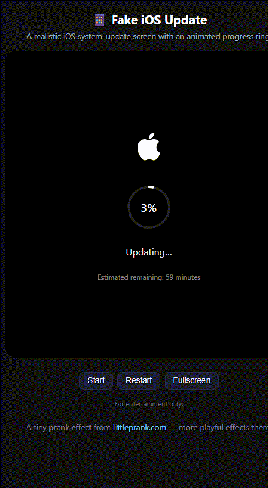

# 📱 Fake iOS Update（假 iOS 更新）

[English version / 英文版本](README.md)

一个拟真的 iOS 系统更新界面，带动态进度环。纯 HTML/CSS/JS，零依赖。

▶ **在线演示（littleprank.com）：** https://littleprank.com/en/tools/mobile/fake-ios-update/



## 效果说明

- 黑色 iOS 风格更新界面，含苹果 logo 与圆形进度环。
- 点击 **Start** 让百分比从 0 动画到 100%。
- **Restart** 重置并重播。
- **Fullscreen** 全屏，更有欺骗感。

## 运行方式

无需构建、无需安装，直接用浏览器打开 `index.html`。

## 核心代码

进度环是一个描边 `<circle>`，通过 `stroke-dashoffset` 跟随百分比推进：

```js
var CIRC = 213.6; // 2 * π * r  (r = 34)
function update() {
  percent = Math.min(100, percent + Math.random() * 2.5);
  arc.style.strokeDashoffset = CIRC * (1 - percent / 100);
  elPercent.textContent = Math.floor(percent) + '%';
}
```

完整可运行版本（含 Start/Restart/Fullscreen）见 **[`index.html`](index.html)**。

## 许可证

MIT。

## 更多 littleprank.com 一键直达

本仓库展示一个效果，但 littleprank.com 上完整的**手机类**工具如下，每条附一句话说明，点击即可直达在线工具：

- [假 iOS 更新](https://littleprank.com/en/tools/mobile/fake-ios-update/) — 模拟 iPhone/iPad 系统更新界面
- [假 Android 更新](https://littleprank.com/en/tools/mobile/fake-android-update/) — 模拟 Android 系统更新安装界面
- [假白苹果修复](https://littleprank.com/en/tools/mobile/fake-white-apple/) — 模拟 iPhone 白苹果刷机卡死
- [假电池严重损坏](https://littleprank.com/en/tools/mobile/fake-battery-damage/) — 模拟手机电池膨胀警告弹窗
- [假 Fastboot 刷机](https://littleprank.com/en/tools/mobile/fake-fastboot/) — 模拟安卓线刷模式分区刷写
- [假系统框架损坏](https://littleprank.com/en/tools/mobile/fake-system-ui-crash/) — 模拟安卓系统 UI 不停崩溃
- [假手机过热降频](https://littleprank.com/en/tools/mobile/fake-phone-overheat/) — 模拟手机温度飙升强制关机
- [假短信轰炸](https://littleprank.com/en/tools/mobile/fake-sms-bomb/) — 手机通知栏不间断批量弹出海量短信消息通知
- [假 App 未读红点](https://littleprank.com/en/tools/mobile/fake-app-badges/) — 屏幕各类应用图标自动生成大量未读红点
- [假视频通话来电](https://littleprank.com/en/tools/mobile/fake-video-call/) — 模拟 FaceTime 视频通话呼入界面，自带来电铃声
- [假指纹面容解锁](https://littleprank.com/en/tools/mobile/fake-fingerprint/) — 手机解锁界面，连续识别失败后触发设备锁定
- [iPhone 已被锁](https://littleprank.com/en/tools/mobile/fake-iphone-lock/) — 模拟 iPhone 停用界面，可自定义锁定时间
- [假来电](https://littleprank.com/en/tools/mobile/fake-call/) — 模拟手机来电界面，自定义来电人
- [假通知](https://littleprank.com/en/tools/mobile/fake-notification/) — 生成手机通知弹窗截图
- [假低电量](https://littleprank.com/en/tools/mobile/fake-battery/) — 模拟手机低电量警告弹窗
- [假电量耗尽](https://littleprank.com/en/tools/mobile/fake-battery-dead/) — 模拟手机电量耗尽自动关机，黑屏转圈圈充电动画
- [假 iOS 恢复模式](https://littleprank.com/en/tools/mobile/fake-ios-restore/) — 模拟 iPhone 恢复模式/刷机进度界面
- [假 Android 刷机](https://littleprank.com/en/tools/mobile/fake-android-flash/) — 模拟 Android 线刷/Recovery 刷机进度
