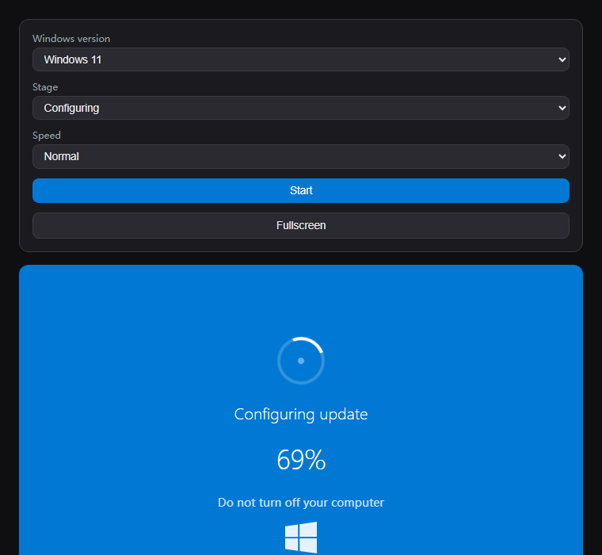

# 🪟 假 Windows 更新

模拟 Windows 10/11 更新界面。选择版本（Win11 蓝屏 / Win10 暗色）、阶段与速度，点击**开始**，进度数字会一路上涨——甚至会像真机一样卡在 97%。纯 HTML/CSS/JS，零依赖。

▶ **在线演示（littleprank.com）：** https://littleprank.com/en/tools/system/fake-windows-update/



## 效果说明

- 可选 **Windows 11**（蓝色）或 **Windows 10**（暗色）风格。
- **开始**后会跑出 0 → 97% 的假进度，偶尔跳到 100% 再"重启"。
- **全屏**按钮填满屏幕，整蛊更逼真。
- 无需构建、无需安装，直接打开 `index.html` 即可。

## 运行方式

用浏览器打开 `index.html`，点击**开始**。

## 核心代码

进度循环只是累加计数并更新文字：

```js
let progress = 0;
const speedMap = { slow: 200, normal: 80, fast: 30 };
setInterval(() => {
  if (progress < 97) {
    progress = Math.min(97, progress + Math.random() * 3 + 0.5);
    percentEl.textContent = Math.floor(progress) + '%';
  } else if (Math.random() > 0.95) {
    percentEl.textContent = '100%';
  }
}, speedMap[speed]);
```

完整可运行版本（含版本/阶段选择与全屏）见 **[`index.html`](index.html)**。

## 许可

MIT。

---

**littleprank.com** 的迷你展示仓库——更多好玩（且无恶意）的效果都在 [littleprank.com](https://littleprank.com)。

## 更多 littleprank.com 一键直达

本仓库展示一个效果，但 littleprank.com 上完整的 **Windows 更新与登录**类屏幕如下，每条附一句话说明，点击即可直达在线工具：

- [假 Windows 更新](https://littleprank.com/en/tools/system/fake-windows-update/) — 模拟 Windows 系统更新界面，整蛊你的朋友
- [假Win11登录](https://littleprank.com/en/tools/system/fake-win11-login/) — Windows 11居中登录界面，圆角设计
- [假Win10登录](https://littleprank.com/en/tools/system/fake-win10-login/) — Windows 10登录界面，简洁现代设计
- [假Win8/8.1登录](https://littleprank.com/en/tools/system/fake-win8-login/) — Windows 8/8.1磁贴登录界面，现代扁平风格
- [假Win7登录](https://littleprank.com/en/tools/system/fake-win7-login/) — Windows 7登录界面，Aero玻璃效果
- [假WinXP登录](https://littleprank.com/en/tools/system/fake-winxp-login/) — Windows XP欢迎界面，经典绿色任务栏
- [假Win98登录](https://littleprank.com/en/tools/system/fake-win98-login/) — Windows 98登录界面，经典蓝天白云
- [假Win95登录](https://littleprank.com/en/tools/system/fake-win95-login/) — 经典Windows 95登录界面，复古灰色风格
- [假 Windows 激活失效](https://littleprank.com/en/tools/system/fake-windows-activate/) — 模拟 Windows 未激活水印和激活失败弹窗
- [假 Windows 锁屏](https://littleprank.com/en/tools/system/fake-windows-lock/) — 模拟 Windows 锁屏界面，输入密码解锁
- [假安全模式启动](https://littleprank.com/en/tools/system/fake-safe-mode-boot/) — 模拟系统安全模式启动诊断界面
- [假系统更新卡死](https://littleprank.com/en/tools/system/fake-update-stuck/) — 系统更新卡在100%不动，或"还剩1分钟"持续半小时
- [假 macOS 更新](https://littleprank.com/en/tools/system/fake-macos-update/) — 模拟 macOS 系统更新安装界面
- [假 macOS 登录](https://littleprank.com/en/tools/system/fake-macos-login/) — 模拟 macOS 锁屏登录界面，输入密码解锁动画
- [假 Chrome 更新](https://littleprank.com/en/tools/system/fake-chrome-update/) — 模拟 Chrome 浏览器更新页面
- [假 Android 更新](https://littleprank.com/en/tools/mobile/fake-android-update/) — 模拟 Android 系统更新安装界面
- [假 Fastboot 刷机](https://littleprank.com/en/tools/mobile/fake-fastboot/) — 模拟安卓线刷模式分区刷写
- [假白苹果修复](https://littleprank.com/en/tools/mobile/fake-white-apple/) — 模拟 iPhone 白苹果刷机卡死

---
