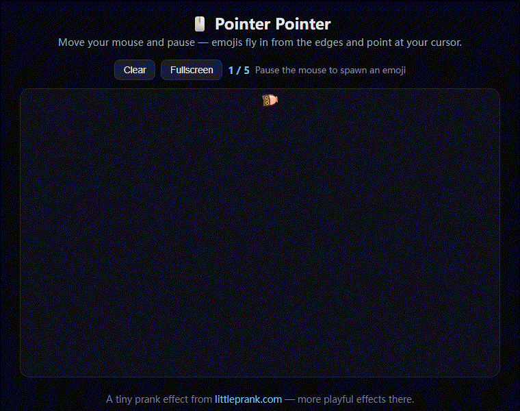

# 🖱️ Pointer Pointer（指针指向）

移动鼠标并**停顿**，emoji 会从屏幕边缘飞入并**指向**你的光标。一个轻量、好玩的恶搞小效果。零依赖，纯 HTML/CSS/JS。

▶ **在线演示（littleprank.com）：** https://littleprank.com/en/tools/prank/pointer-pointer/



## 效果说明

- 检测鼠标静止约 300 毫秒。
- 从随机屏幕边缘生成一个随机 emoji。
- emoji 飞入并旋转到**指向**光标位置。
- 存活约 2 秒后淡出。最多同时 5 个。
- 支持触屏与全屏。

## 运行方式

无需构建、无需安装，直接用浏览器打开 `index.html` 即可。

## 核心代码

完整效果是一个自包含文件（`index.html`）。核心逻辑——生成并指向光标的代码：

```js
var EMOJIS = ['👆','👇','👈','👉','🐱','🐶','🦊','🐼','🐸','🦉','🐵','🐰','👀','🤔','😎','🥳','👋','🫵','🤙','🙌','✌️','🤞'];
var MAX = 5, PAUSE = 300, LIFE = 2000, active = [];

function pointAngle(ex, ey, mx, my) {
  return Math.atan2(my - ey, mx - ex) * 180 / Math.PI;
}

function spawn(mx, my) {
  if (active.length >= MAX || fsCooldown) return;
  var rect = stage.getBoundingClientRect();
  var sw = rect.width, sh = rect.height;
  if (sw < 2 || sh < 2) return;
  var size = 40 + Math.random() * 40;
  var tx = mx + (Math.random() - 0.5) * 100;
  var ty = my + (Math.random() - 0.5) * 100;
  var edge = (Math.random() * 4) | 0, sx, sy;
  if (edge === 0) { sx = Math.random() * sw; sy = -size; }
  else if (edge === 1) { sx = sw + size; sy = Math.random() * sh; }
  else if (edge === 2) { sx = Math.random() * sw; sy = sh + size; }
  else { sx = -size; sy = Math.random() * sh; }
  var el = document.createElement('span');
  el.textContent = EMOJIS[(Math.random() * EMOJIS.length) | 0];
  el.style.fontSize = size + 'px';
  el.style.transform = 'translate(' + sx + 'px,' + sy + 'px) rotate(' + (Math.random()*360-180) + 'deg) scale(0.2)';
  stage.appendChild(el);
  requestAnimationFrame(function () { requestAnimationFrame(function () {
    el.style.transition = 'transform .55s cubic-bezier(.2,.9,.3,1.3), opacity .3s';
    el.style.opacity = '1';
    el.style.transform = 'translate(' + tx + 'px,' + ty + 'px) rotate(' + pointAngle(tx, ty, mx, my) + 'deg) scale(1)';
  }); });
  var rec = { el: el };
  active.push(rec);
  rec.timer = setTimeout(function () { fadeOut(rec); }, LIFE);
}
```

完整可运行版本（含淡出、清除、全屏、触屏）见 **[`index.html`](index.html)**。

## 许可证

MIT —— 随便用。

## 更多 littleprank.com 一键直达

本仓库只展示其中一个效果——以下是 littleprank.com 同分类下的全部工具，每个链接都直达在线版：

- [Fake Cert Warning](https://littleprank.com/en/tools/prank/fake-cert-warning/)
- [Fake Bitlocker](https://littleprank.com/en/tools/prank/fake-bitlocker/)
- [Fake Clipboard Hijack](https://littleprank.com/en/tools/prank/fake-clipboard-hijack/)
- [Fake Password Input](https://littleprank.com/en/tools/prank/fake-password-input/)
- [Fake Fbi Warning](https://littleprank.com/en/tools/prank/fake-fbi-warning/)
- [Fake Japanese Fbi Warning](https://littleprank.com/en/tools/prank/fake-japanese-fbi-warning/)
- [Fake Ransomware](https://littleprank.com/en/tools/prank/fake-ransomware/)
- [Fake Camera Recording](https://littleprank.com/en/tools/prank/fake-camera-recording/)
- [Fake Achievement](https://littleprank.com/en/tools/prank/fake-achievement/)
- [Fake Gacha](https://littleprank.com/en/tools/prank/fake-gacha/)
- [Fake Attendance Fail](https://littleprank.com/en/tools/prank/fake-attendance-fail/)
- [Fake Git Merge Conflict](https://littleprank.com/en/tools/prank/fake-git-merge-conflict/)
- [Fake Meeting Fullscreen](https://littleprank.com/en/tools/prank/fake-meeting-fullscreen/)
- [Fake Stock Surge](https://littleprank.com/en/tools/prank/fake-stock-surge/)
- [Fake Sneaker Drop](https://littleprank.com/en/tools/prank/fake-sneaker-drop/)
- [Fake Nft Mint](https://littleprank.com/en/tools/prank/fake-nft-mint/)
- [Fake Wallet Connect](https://littleprank.com/en/tools/prank/fake-wallet-connect/)
- [Fake Airdrop](https://littleprank.com/en/tools/prank/fake-airdrop/)
- [Fake Ddos Warning](https://littleprank.com/en/tools/prank/fake-ddos-warning/)
- [Boss Key](https://littleprank.com/en/tools/prank/boss-key/)
- [Fake Progress Gen](https://littleprank.com/en/tools/prank/fake-progress-gen/)
- [Fake Notification Bomb](https://littleprank.com/en/tools/prank/fake-notification-bomb/)
- [Surveillance Prank](https://littleprank.com/en/tools/prank/surveillance-prank/)
- [Fake Mouse Action](https://littleprank.com/en/tools/prank/fake-mouse-action/)
- [Fake Saas Dashboard](https://littleprank.com/en/tools/prank/fake-saas-dashboard/)
- [Fake Ai Chat](https://littleprank.com/en/tools/prank/fake-ai-chat/)
- [Fake Vscode](https://littleprank.com/en/tools/prank/fake-vscode/)
- [Fake Wechat Redpack](https://littleprank.com/en/tools/prank/fake-wechat-redpack/)
- [Random Picker](https://littleprank.com/en/tools/prank/random-picker/)
- [Soundboard](https://littleprank.com/en/tools/prank/soundboard/)
- [Jump Scare Prank](https://littleprank.com/en/tools/prank/jump-scare-prank/)
- [Useless Buttons](https://littleprank.com/en/tools/prank/useless-buttons/)
- [Pointer Pointer](https://littleprank.com/en/tools/prank/pointer-pointer/)
- [Fake Weather Forecast](https://littleprank.com/en/tools/prank/fake-weather-forecast/)
- [Fake Earthquake Alert](https://littleprank.com/en/tools/prank/fake-earthquake-alert/)
- [Wooden Fish](https://littleprank.com/en/tools/prank/wooden-fish/)
- [Incense Burner](https://littleprank.com/en/tools/prank/incense-burner/)
- [Prayer Beads](https://littleprank.com/en/tools/prank/prayer-beads/)
- [Time Waster](https://littleprank.com/en/tools/prank/time-waster/)

---


---

本仓库是 **[littleprank.com](https://littleprank.com)** 的一个小展示 —— 更多好玩（且无恶意）的效果都在那里。
